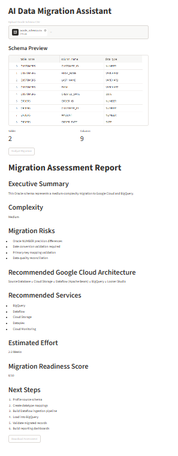
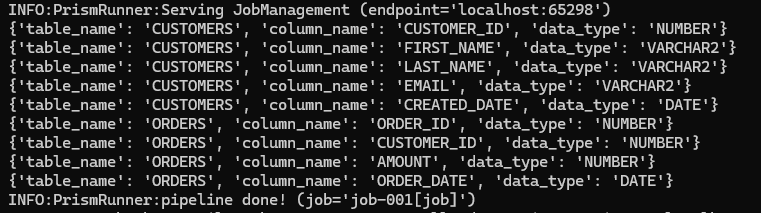

# AI Data Migration Assessment Assistant

## Overview

The AI Data Migration Assessment Assistant is a consulting-focused accelerator that analyzes Oracle database schemas and generates migration recommendations aligned with Google Cloud best practices.

This project demonstrates data engineering, schema profiling, cloud modernization planning, and migration consulting concepts using Python, Apache Beam, and Streamlit.

---

## Features

- Upload Oracle schema CSV files
- Analyze schema metadata
- Generate migration readiness assessments
- Recommend Google Cloud architecture
- Demonstrate Apache Beam processing
- Generate downloadable migration reports

---

## Technology Stack

- Python
- Streamlit
- Apache Beam
- Pandas
- Google Cloud Architecture Concepts
- BigQuery
- Dataflow
- Cloud Storage

---

## Architecture

```text
Oracle Schema CSV
        |
        v
Apache Beam Pipeline
        |
        v
Schema Profiling
        |
        v
Migration Assessment Engine
        |
        v
Google Cloud Recommendations
        |
        v
Streamlit Dashboard
```

## Folder Structure

```text
AI-Data-Migration-Assessment-Assistant
│
├── app
│   ├── __init__.py
│   ├── main.py
│   ├── migration_agent.py
│   └── beam_pipeline.py
│
├── data
│   └── oracle_schema.csv
│
├── screenshots
│   ├── dashboard.png
│   └── beam_output.png
│
├── README.md
├── requirements.txt
├── .gitignore
└── LICENSE
```

## Sample Input

```csv
table_name,column_name,data_type
CUSTOMERS,CUSTOMER_ID,NUMBER
CUSTOMERS,FIRST_NAME,VARCHAR2
CUSTOMERS,LAST_NAME,VARCHAR2
CUSTOMERS,EMAIL,VARCHAR2
CUSTOMERS,CREATED_DATE,DATE
ORDERS,ORDER_ID,NUMBER
ORDERS,CUSTOMER_ID,NUMBER
ORDERS,AMOUNT,NUMBER
ORDERS,ORDER_DATE,DATE
```

## Sample Output

### Migration Assessment Report

**Complexity:** Medium

**Migration Risks**

- Oracle NUMBER precision differences
- Date conversion validation
- Primary key mapping review
- Data quality reconciliation

**Recommended Services**

- BigQuery
- Dataflow
- Cloud Storage
- Dataplex
- Cloud Monitoring

**Estimated Effort**

2–3 Weeks

**Migration Readiness Score**

8/10

---

## Screenshots

### Application Dashboard



### Apache Beam Execution



---

## Installation

Clone repository:

```bash
git clone https://github.com/Shailja-Jindal/AI-Data-Migration-Assessment-Assistant.git
```

Move into project:

```bash
cd AI-Data-Migration-Assessment-Assistant
```

Create virtual environment:

```bash
python -m venv venv
```

Activate virtual environment:

```bash
venv\Scripts\activate
```

Install dependencies:

```bash
pip install -r requirements.txt
```

---

## Run Streamlit Application

```bash
streamlit run app/main.py
```

Open:

```text
http://localhost:8501
```

---

## Run Apache Beam Pipeline

```bash
python app/beam_pipeline.py
```

Example Output:

```text
{'table_name': 'CUSTOMERS', 'column_name': 'CUSTOMER_ID', 'data_type': 'NUMBER'}
{'table_name': 'CUSTOMERS', 'column_name': 'FIRST_NAME', 'data_type': 'VARCHAR2'}
{'table_name': 'CUSTOMERS', 'column_name': 'LAST_NAME', 'data_type': 'VARCHAR2'}

Pipeline completed successfully.
```

---

## Skills Demonstrated

- Data Migration Assessment
- Apache Beam
- Data Engineering
- Cloud Architecture Design
- BigQuery Modernization
- ETL and ELT Concepts
- Streamlit Dashboard Development
- Python Development
- Technical Consulting

---

## Future Enhancements

- Gemini-powered migration analysis
- BigQuery DDL generation
- Dataflow deployment
- Cloud Run deployment
- Migration cost estimation
- Google ADK integration

---

## Author

Shailja Jindal

LinkedIn:
https://linkedin.com/in/shailja-jindal

GitHub
